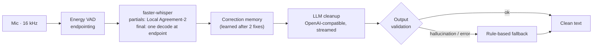

# flowlite

**Streaming voice dictation, end to end, with honest latency and edit-rate benchmarks.**

Mic → energy-VAD endpointing → streaming **faster-whisper** (Local-Agreement partials) → "correct-it-twice" memory → **small-LLM cleanup** (streamed, validated, with a rule-based fallback) → clean text.
Everything runs locally by default (faster-whisper + Ollama). No audio leaves your machine.

> Independent learning project, built to explore the problem of *dictation that never needs editing*. Not affiliated with any company.



## Quick start

```bash
git clone <this-repo> && cd flowlite
python -m venv .venv && source .venv/bin/activate
pip install -e ".[all]"            # Linux also needs: sudo apt install libportaudio2

# a small local LLM for cleanup (any OpenAI-compatible server works)
#install ollama for windows:
irm https://ollama.com/install.ps1 | iex

#intsall ollama for Linux:
curl -fsSL https://ollama.com/install.sh | sh

#install for macOs:
curl -fsSL https://ollama.com/install.sh | sh

ollama pull qwen2.5:1.5b

flowlite doctor                    # checks deps + LLM endpoint
flowlite live                      # speak, pause, see raw vs clean + latency
```

No microphone handy? These need no audio:

```bash
flowlite clean "um hey can you can you send me the the report" --cleaner rules
flowlite bench-cleanup --backends raw,rules,llm
pytest -q
```

Other entry points: `flowlite transcribe file.wav`, `flowlite teach "sa hodge" "Sahaj"` (active after 2 repeats), `flowlite serve` (FastAPI + WebSocket).

## Windows: NVIDIA GPU setup for faster-whisper

If `flowlite live --device cuda` fails with an error such as `cublas64_12.dll is not found or cannot be loaded`, install the CUDA 12 cuBLAS and cuDNN 9 runtime packages into the same Python environment as Flowlite. Make sure your NVIDIA GPU driver is installed and up to date first.

In PowerShell, activate the project virtual environment, then run:

```powershell
python -m pip install nvidia-cublas-cu12 "nvidia-cudnn-cu12==9.*"

# Add the installed CUDA runtime DLL folders to PATH for this terminal session.
$sp = python -c "import site; print(site.getsitepackages()[-1])"
$env:PATH = "$sp\nvidia\cublas\bin;$sp\nvidia\cudnn\bin;$env:PATH"

flowlite live --device cuda --compute-type float16
```

The `PATH` update above applies only to the current PowerShell window. If you open another terminal, activate the virtual environment and run the `$sp` and `$env:PATH` commands again. To use the CPU instead, omit CUDA and run `flowlite live --device cpu --compute-type int8`.

## What's interesting here

| Piece | What it does | Why |
|---|---|---|
| `streaming.py` | Re-frames audio into 30 ms frames, endpoints on silence, re-decodes the growing utterance every ~1 s and reports words two consecutive hypotheses agree on as *stable* (Local Agreement-2, from [whisper_streaming](https://github.com/ufal/whisper_streaming)). | Live feedback without committing to unstable words. Pure Python + numpy, fully unit-tested with a scripted fake ASR. |
| `cleanup.py` | Streams a chat completion from any OpenAI-compatible endpoint, measures **time-to-first-token**, and validates the output (empty / too long / too short / novel content) before accepting it. | A 1.5B model can answer the transcript instead of cleaning it. The guard routes those cases to a deterministic fallback so bad generations never reach the user. |
| `personalization.py` | Counts user corrections; after the same fix twice it is applied to raw ASR text *before* the LLM. Also feeds a personal dictionary into Whisper's `initial_prompt` and the LLM prompt. | Cheap, local, and measurable personalization. |
| `metrics.py`, `bench.py` | Strict/lenient zero-edit rate, WER, char-edit ratio, p50/p90/p95/p99 latency, TTFT, RTF, fallback rate, per-category breakdown. | Quality *and* latency in one table, plus error analysis (`--failures N`). |
| `server.py` | WebSocket: PCM16 in → `partial` / `final` / `clean` JSON events out, with `after_endpoint_ms` per utterance. One shared model behind a lock; decode runs off the event loop. | Shows how the same core serves many connections. |

## Latency model

What the user feels after they stop talking:

```
post-speech latency = endpoint silence  +  final ASR decode  +  cleanup (LLM)
                      (--endpoint-ms)      (model, device)      (TTFT + generation)
```

* `--endpoint-ms` trades responsiveness for cut-offs mid-sentence (default 500).
* ASR: smaller/quantised model (`tiny.en`, `base.en`, int8) or GPU (`--device cuda --compute-type float16`). Partial decodes are *extra* load; disable with `--partial-s 0`.
* LLM: keep the model hot (`OLLAMA_KEEP_ALIVE=1h`; the CLI also warms it up). The system prompt + few-shot are identical on every call, so servers with prefix caching (llama.cpp, vLLM, Ollama) only pay for the new transcript tokens.
* `flowlite live` prints `after-endpoint` (ASR + cleanup, measured from the moment the endpoint fired) next to the endpoint silence so the budget is visible.

## Benchmarks

### Metrics

| Metric | Definition |
|---|---|
| **zero-edit (strict)** | Output equals the reference after whitespace collapse. Case and punctuation must match: "would the user have to touch it?" |
| **zero-edit (lenient)** | Equal after lower-casing, punctuation removal and `6 p.m.` ≡ `6pm`. |
| **WER** | Micro-averaged word error rate on lenient tokens. |
| **char-edit** | Levenshtein(output, reference) / len(reference), a rough "keystrokes to fix". |
| **TTFT / p50 / p95** | Time to first streamed token / latency percentiles over all calls (`--repeats`, after `--warmup`). |

### 1. Text cleanup (`flowlite bench-cleanup`)

27 hand-written disfluent transcripts in `data/samples.jsonl` (fillers, repetitions, self-corrections, questions, phonetic name errors, punctuation) with a single unambiguous reference each. Baselines measured on CPU, no LLM:

| backend | n | zero-edit (strict) | zero-edit (lenient) | WER | char-edit |
|---|---|---|---|---|---|
| raw (no cleanup) | 27 | 0% | 19% | 28% | 38% |
| rules (regex baseline) | 27 | 44% | 59% | 15% | 19% |

The regex baseline is perfect on fillers and adjacent stutters and fails on exactly what needs understanding: non-adjacent repetitions, name/word corrections ("to Marcus, sorry, to Maria"), false starts and phonetic name fixes. That gap is what the LLM row measures. Run `make bench-cleanup`; the full table (including the `llm:<model>` row and per-category breakdown) is written to `results/latest_cleanup.md`.

### 2. End to end on your own voice (`flowlite bench-e2e`)

```bash
python scripts/record_dataset.py      # read each prompt naturally, um's and corrections included
flowlite bench-e2e --backends raw,rules,llm
```

Replays each recording through the *streaming* path (VAD, endpointing, final decode), then evaluates every cleanup backend on the same ASR output. Reports quality plus ASR latency, real-time factor and **post-speech latency**. Results land in `results/latest_e2e.md`.

### Caveats (read before trusting any number)

* The 27 samples are synthetic and small. Treat results as a regression harness and an ablation, not a leaderboard. Add your own to `data/samples.jsonl`.
* Whisper often drops "um/uh" by itself, so ASR-only looks better on real audio than on the verbatim-style text benchmark. That is why both benchmarks exist.
* `fallback` shows how often the guard rejected the LLM. A good zero-edit rate with a high fallback rate means the rules, not the model, did the work.
* Latency depends heavily on hardware, model size and quantisation. Always report the model and device next to the numbers (the tables include them).

## Server

```bash
flowlite serve --port 8000
```

Open [http://127.0.0.1:8000](http://127.0.0.1:8000) in a browser for the demo UI. Allow microphone access to try live dictation; browsers generally permit microphone access on `localhost` and secure HTTPS origins. The page also includes a text-only cleanup tester.

The API is available alongside the UI:

```text
# POST /clean {"text": "...", "style": "formal"}
# WS   /ws     binary: 16 kHz mono int16 PCM · text "flush" ends the utterance
#       <- {"type":"partial","stable":"...","tentative":"..."}
#       <- {"type":"final","text":"..."}                         (raw ASR)
#       <- {"type":"clean","text":"...","cleanup_ms":..,"ttft_ms":..,"after_endpoint_ms":..}
```

For the component diagram, module hierarchy, and workflow diagrams, see
[docs/architecture.md](./docs/architecture.md).

## Layout

```
src/flowlite/  vad · asr · streaming · cleanup · personalization · metrics · bench · server · cli
data/          samples.jsonl (benchmark set) · dictionary.txt · audio/ (your recordings, git-ignored)
scripts/       record_dataset.py
tests/         VAD/endpointing, local agreement, LLM client (mock SSE), fallback, metrics, server (WebSocket)
```

## Known limitations / roadmap

* **VAD:** energy-based with an adaptive noise floor. Swap in Silero/WebRTC VAD for noisy rooms.
* **Partials re-decode the whole utterance** (simple, robust). Production streaming would use word timestamps with a committed-audio buffer, or a natively streaming model, to bound cost per partial.
* **Decode runs synchronously in the capture loop** in `live`. The server offloads to threads; a real client would use a dedicated worker with backpressure.
* **Speculative cleanup:** start the LLM on the stable prefix while the user is still speaking, and only re-run the tail at the endpoint, to hide most of the cleanup latency.
* **Learning from edits:** the correction memory is count-based. Logging (raw, clean, user-edit) triples would enable fine-tuning or preference optimisation of the cleanup model against edit rate directly.
* **Calibrated confidence:** gate risky rewrites (names, numbers) on model confidence and fall back to the literal ASR text.
* **Multilingual / code-switching:** set `--language auto` with a multilingual Whisper model; the benchmark set is English-only today.

## License

MIT
