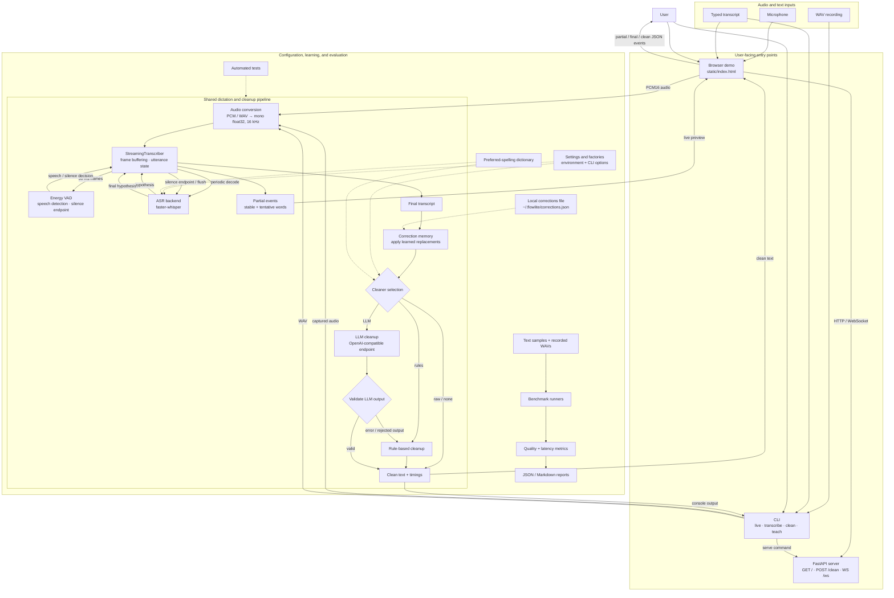
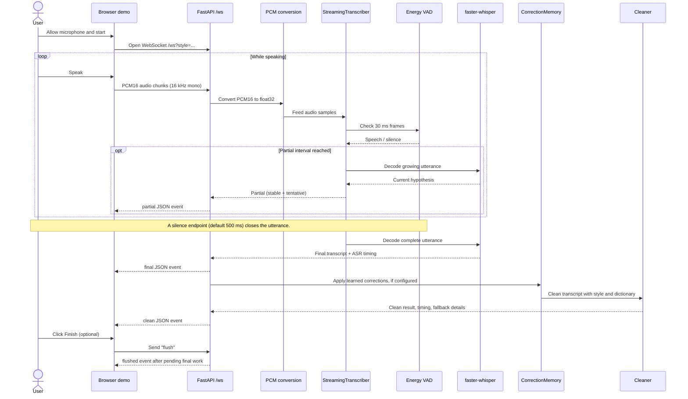
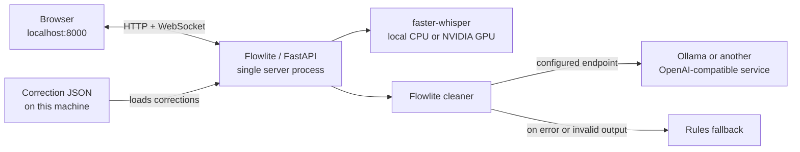

# Flowlite architecture

Flowlite is a local-first dictation application. It has two user-facing entry
points—the browser demo and the command-line interface—and a shared Python
pipeline for speech detection, recognition, and transcript cleanup.

## 1. Logical architecture



### Reading the diagram

- **Entry points** determine how a request enters the app. The browser is a
  static page served by FastAPI; it is not a separate frontend server. The CLI
  can run the same pipeline directly or start the FastAPI server.
- **The streaming core** collects audio into utterances. VAD decides when speech
  starts and when a pause ends an utterance; it does not recognize words.
- **ASR** is faster-whisper. During speech, periodic decodes may produce partial
  previews. At an endpoint, a final decode produces the transcript used by
  cleanup.
- **Cleanup** is selectable: passthrough, deterministic rules, or an
  OpenAI-compatible LLM. LLM output is validated; rejected output or request
  errors use the rules-based fallback.
- **Support components** provide runtime configuration, vocabulary hints,
  correction memory, tests, and offline quality/latency measurement.

## 2. Live dictation sequence



The sequence shows the browser server path. `flowlite live` follows the same
speech pipeline, but reads audio from the local microphone and prints events in
the terminal. `flowlite transcribe` loads a WAV and runs the same endpointing
logic with partial decoding disabled.

## 3. Module hierarchy

```text
flowlite
├── Entry points
│   ├── cli.py                 command parsing and command workflows
│   ├── server.py              browser page, HTTP API, WebSocket API
│   └── static/index.html      browser demo UI
├── Speech pipeline
│   ├── audio_io.py            WAV and PCM conversion, audio chunking
│   ├── streaming.py           frame buffering, utterance state, partial/final events
│   ├── vad.py                 energy-based speech/silence detection
│   └── asr.py                 faster-whisper backend and shared-model lock
├── Transcript processing
│   ├── personalization.py     local correction counts and replacements
│   └── cleanup.py             passthrough, rules, LLM, validation, fallback
├── Configuration and evaluation
│   ├── config.py              environment settings and backend factories
│   ├── bench.py               benchmark loading, execution, and report writing
│   └── metrics.py             edit quality and latency calculations
├── data/
│   ├── samples.jsonl          text cleanup benchmark examples
│   ├── dictionary.txt         optional preferred spellings
│   └── audio/                 optional user-recorded benchmark WAVs
├── scripts/record_dataset.py  record benchmark prompts
└── tests/                     unit and integration tests
```

## 4. Runtime and deployment view



`flowlite serve` starts the backend and serves the browser UI from the same
origin, so a separate frontend development server is not required. The ASR
model runs on the configured device. The LLM can be local (for example Ollama)
or remote if configured; in the remote case, transcript text is sent to that
service for cleanup.

## 5. Other workflows

| Workflow | Components used | Result |
|---|---|---|
| `flowlite clean "..."` | CLI → correction memory → selected cleaner | Cleaned text; no audio or ASR |
| `POST /clean` | Browser/API → selected cleaner | JSON cleanup result; no audio or ASR |
| `flowlite teach wrong right` | CLI → correction memory | A locally stored correction, active after two repetitions |
| `flowlite bench-cleanup` | Samples → cleaner backends → metrics | Text quality/latency reports |
| `flowlite bench-e2e` | WAVs → streaming/VAD/ASR → cleaners → metrics | End-to-end quality and latency reports |
| `flowlite doctor` | CLI → dependency imports and LLM health check | Environment diagnostics |
